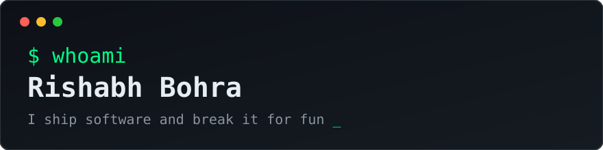

## What I'm building

**Scoot** — companion app for TVS smart scooters. Live telemetry, trip history, turn-by-turn nav mirrored to the cluster, media and call controls over BLE. Protocol fully reverse-engineered from the official app.
[repo](https://github.com/sudo-Mystic/Scoot)

**detroit-jev** — an engine that plays Detroit: Become Human start to finish, with an AI making all 226 story decisions live through a real game backend.
[repo](https://github.com/sudo-Mystic/detroit-jev)

**Android security research** — static and dynamic teardown of apps. 

---
